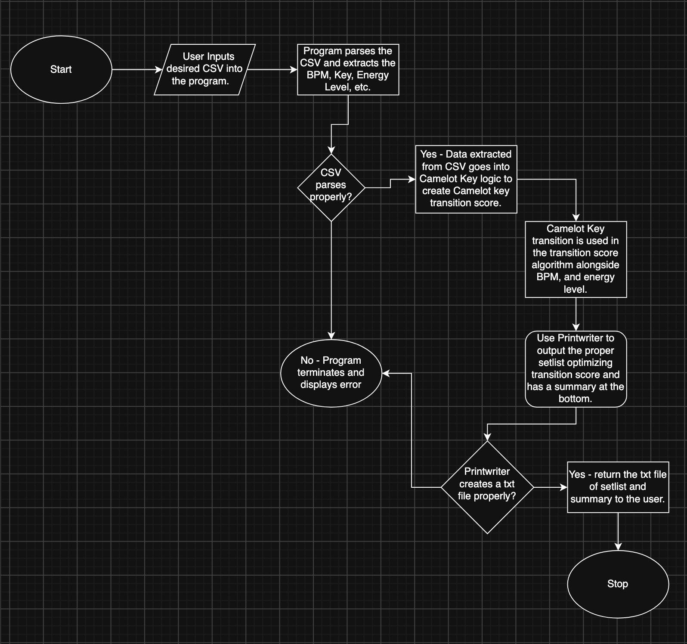

# ShuffleSet

A terminal based Java program that takes a CSV file of setlist data as input and optimizes the setlist for optimal song transitions.

## The Problem

I got into DJ'ing  and mixing music near the start of my senior year, and I thought blending tracks was just a skill gap because of my beginner status. Even though I rapidly improved, choosing the perfect order for my set list was still a struggle because I had to juggle BPM, key, and energy for every neighboring pair all at once. This struggle is the problem that I am trying to solve for myself and other fellow DJ's.

## How It Works

- Creates a terminal based prompt asking user to input a CSV file of setlist information including BPM, Key, and energy levels.
- The program parses this CSV and uses Camelot Key Logic to create a key compatibility score for each pair.
- BPM, key compatability, and energy levels are used to give each pair of songs a transition score.
- The transition scores between songs are maximized to provide a setlist with the smoothest transitions.
- This optimized setlist is returned as a txt file in the terminal to the user.



## Tech Stack

- **Language:** Java
- **External tools:** Exportify, Tunebat

## Setup

1. Clone the repo:
   ```bash
   git clone https://github.com/Arpit-Ahuja-293/ShuffleSet.git
   cd ShuffleSet
   ```
2. Compile:
   ```bash
   javac -cp "lib/*" -d out/production/ShuffleSet src/main/java/shuffleset/*.java
   ```

## Usage

1. **Make your CSV.** Export a Spotify playlist with [Exportify](https://exportify.net). Then add three columns at the end, using values from [Tunebat](https://tunebat.com):
    - `BPM`: tempo, a whole number greater than 0
    - `Camelot`: key in Camelot notation, `1A`–`12B`
    - `Energy`: 0–100

   See `data/samples/main.csv` for an example.

2. **Run:**
   ```bash
   java -cp "out/production/ShuffleSet:lib/*" shuffleset.Main
   ```
   When it asks for a filename, enter the path to your CSV, for example `data/samples/main.csv`.

3. **Read the output.** The terminal shows the new order and the score before and after. The full set list is saved to `output/<name>-setlist.txt`. It has:
    - the ordered track table
    - each transition with its score and a mixing tip
    - a summary of the total score, before vs. after, and the average
    - weak spots: transitions scoring below 50

Rows with bad values (missing BPM, invalid key, energy out of range, duplicates) are skipped with a warning.

### Running tests
```bash
javac -cp "lib/*" -d out/test src/main/java/shuffleset/*.java src/test/java/shuffleset/*.java
java -jar lib/junit-platform-console-standalone-1.14.4.jar execute \
  -cp "out/test:lib/commons-csv-1.14.1.jar:lib/commons-io-2.20.0.jar:lib/commons-codec-1.19.0.jar" \
  --scan-classpath
```

## Roadmap

Features you haven't built yet but plan to (pull these from your
"Schedule" quadrant in the Eisenhower Matrix).

- [ ] Cool GUI showing list getting reordered live
- [ ] Suggesting songs that the DJ could add
- [ ] Use voice commands to remix whenever and show the txt, as well as what song to play next
- [ ] Adding a search feature where the DJ can add songs to the CSV by putting the name of the song in and instantly re-optimizing the set list
- [ ] Detailed fade instructions (timing in bars, EQ, effects)

## Author

Arpit Ahuja, https://github.com/Arpit-Ahuja-293
