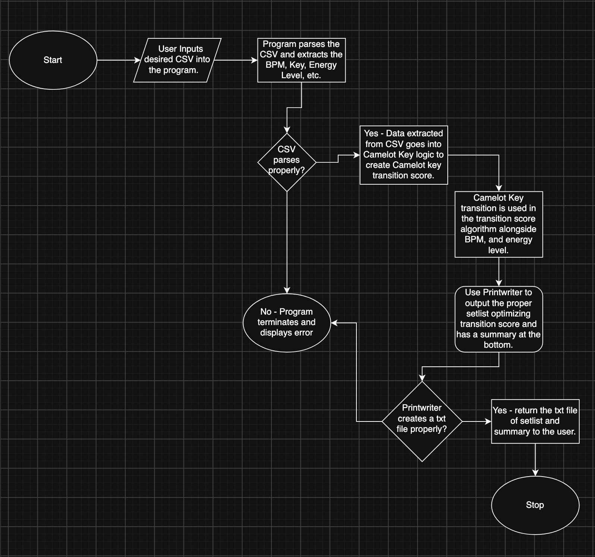

# ShuffleSet

A terminal based Java program that takes a CSV file of setlist data as input and optimizes the setlist for optimal song transitions.

## The Problem

I got into DJ'ing  and mixing music near the start of my senior year, and I thought blending tracks was just a skill gap because of my beginner status. Even though I rapidly improved, choosing the perfect order for my set list was still a struggle because I had to juggle BPM, key, and energy for every neighboring pair all at once. This struggle is the problem that I am trying to solve for myself and other fellow DJ's.

## How It Works

- Creates a terminal based prompt asking user to input a CSV file of setlist information including BPM, Key, and energy levels.
- The program parses this CSV and uses Camelot Key Logic to create a key compatibility score for each pair.
- BPM, key compatability, and energy levels are used to give each pair of songs a transition score.
- The transition scores between songs are minimized to provide a setlist with the smoothest transitions.
- This optimized setlist is returned as a txt file in the terminal to the user.

## Tech Stack

- **Language:** Java
- **External tools:** Exportify, Tunebat

## Setup

TBD

## Usage

TBD

## Roadmap

Features you haven't built yet but plan to (pull these from your
"Schedule" quadrant in the Eisenhower Matrix).

- [ ] Cool GUI showing list getting reordered live
- [ ] Suggesting songs that the DJ could add
- [ ] Use voice commands to remix whenever and show the txt, as well as what song to play next
- [ ] Adding a search feature where the DJ can add songs to the CSV by putting the name of the song in and instantly re-optimizing the set list
- [ ] Detailed fade instructions (timing in bars, EQ, effects)

## Author

Arpit Ahuja, https://github.com/Arpit-Ahuja-293
